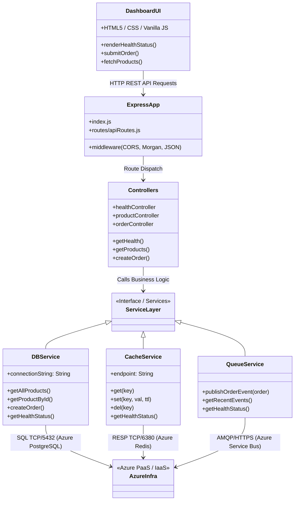
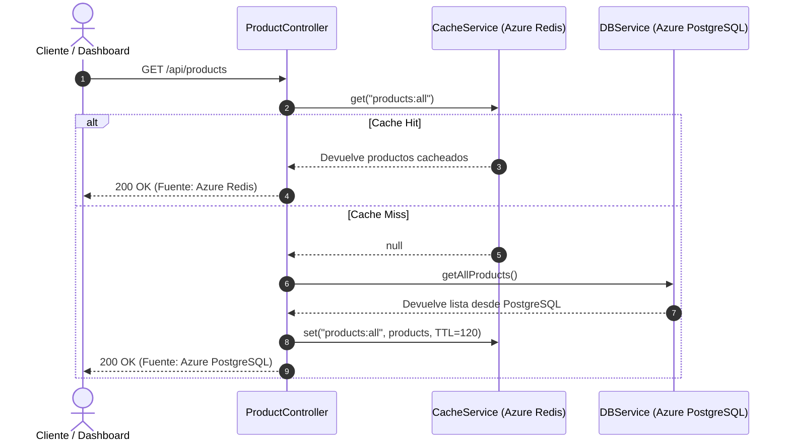
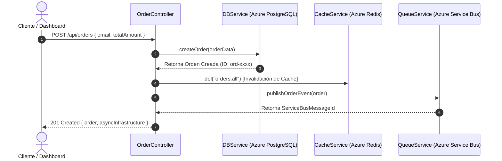

# Diagrama de Componentes del Proyecto Ficticio (Software Architecture)

Este documento detalla la estructura modular de código de la aplicación Node.js / Express y cómo interactúa cada componente de software con la infraestructura de Azure.

---

## 🧩 Diagrama de Componentes de Software (Mermaid)

---

## 🔄 Flujo de Trabajo de las Operaciones Clave

### 1. Patrón Cache-Aside en Consulta de Productos (`GET /api/products`)

### 2. Creación de Orden Asíncrona (`POST /api/orders`)

