# Mapa de Dependencias de Infraestructura como Código (IaC Terraform Azure)

Este documento está diseñado específicamente para que un **agente externo de IA** o herramienta analizadora de IaC pueda mapear y generar automáticamente diagramas de infraestructura a partir de la configuración Terraform en `infrastructure/terraform/`.

---

## 🖼️ Diagrama Generado Automáticamente por Terminal (`terraform graph + dot`)

> **Nota**: Este gráfico fue generado directamente por la terminal ejecutando `terraform graph | dot -Tpng -o docs/terraform_graph.png`. También puedes encontrar el archivo vectorial listo para escalar en [docs/terraform_graph.svg](file:///home/miguel/Proyectos/cloud-mart-platform/docs/terraform_graph.svg).

---

## 📊 Grafo de Dependencias de Recursos Terraform (Mermaid)

```mermaid
graph TD
    subgraph ResourceGroup ["azurerm_resource_group.rg"]
        RG["rg-cloudmart-prod"]
    end

    subgraph Network ["Virtual Network & Subnets"]
        VNet["azurerm_virtual_network.vnet"]
        SubnetAppGw["azurerm_subnet.snet_appgw"]
        SubnetApp["azurerm_subnet.snet_app"]
        SubnetDB["azurerm_subnet.snet_db"]
        SubnetCache["azurerm_subnet.snet_cache"]
        NSGApp["azurerm_network_security_group.nsg_app"]
    end

    subgraph SecurityIdent ["Security & Monitoring"]
        Identity["azurerm_user_assigned_identity.app_identity"]
        KeyVault["azurerm_key_vault.kv"]
        LogAnalytics["azurerm_log_analytics_workspace.logs"]
        AppInsights["azurerm_application_insights.appinsights"]
    end

    subgraph StorageCompute ["Compute & Data Stores"]
        ACR["azurerm_container_registry.acr"]
        CAE["azurerm_container_app_environment.env"]
        ContainerApp["azurerm_container_app.api"]
        PostgresFS["azurerm_postgresql_flexible_server.postgres"]
        PostgresDB["azurerm_postgresql_flexible_server_database.db"]
        Redis["azurerm_redis_cache.redis"]
        ServiceBus["azurerm_servicebus_namespace.sb"]
        SBQueue["azurerm_servicebus_queue.order_queue"]
        StorageAccount["azurerm_storage_account.st"]
        AppGW["azurerm_application_gateway.appgw"]
    end

    %% Parent Dependencies
    VNet --> RG
    SubnetAppGw --> VNet
    SubnetApp --> VNet
    SubnetDB --> VNet
    SubnetCache --> VNet
    NSGApp --> RG

    %% Compute Dependencies
    CAE --> SubnetApp
    CAE --> LogAnalytics
    ContainerApp --> CAE
    ContainerApp --> ACR
    ContainerApp --> Identity

    %% Database & Cache Dependencies
    PostgresFS --> SubnetDB
    PostgresFS --> RG
    PostgresDB --> PostgresFS
    Redis --> RG

    %% Messaging & Storage
    ServiceBus --> RG
    SBQueue --> ServiceBus
    StorageAccount --> RG

    %% Security Dependencies
    KeyVault --> Identity
    AppInsights --> LogAnalytics

    %% Ingress Gateway
    AppGW --> SubnetAppGw
    AppGW --> ContainerApp
```

---

## 📋 Lista de Recursos y Conexiones clave para Agentes Externos

| Nombre del Recurso Terraform | Tipo de Recurso Azure | Componente Asociado | Dependencias Principales |
| :--- | :--- | :--- | :--- |
| `azurerm_resource_group.rg` | Resource Group | Contenedor principal de recursos | Ninguna |
| `azurerm_virtual_network.vnet` | Virtual Network | Red virtual aislada `10.0.0.0/16` | `azurerm_resource_group.rg` |
| `azurerm_subnet.snet_app` | Subnet | Subred delegada para Container Apps | `azurerm_virtual_network.vnet` |
| `azurerm_subnet.snet_db` | Subnet | Subred delegada para PostgreSQL | `azurerm_virtual_network.vnet` |
| `azurerm_subnet.snet_appgw` | Subnet | Subred pública para Ingress Gateway | `azurerm_virtual_network.vnet` |
| `azurerm_container_app.api` | Container App | Servidor API Microservicio Node.js | `azurerm_container_app_environment.env`, `azurerm_postgresql_flexible_server.postgres`, `azurerm_redis_cache.redis`, `azurerm_servicebus_namespace.sb` |
| `azurerm_postgresql_flexible_server.postgres` | PostgreSQL Server | Base de datos relacional principal | `azurerm_subnet.snet_db`, `azurerm_private_dns_zone` |
| `azurerm_redis_cache.redis` | Redis Cache | Capa de Cache In-Memory | `azurerm_resource_group.rg` |
| `azurerm_servicebus_namespace.sb` | Service Bus | Cola y Tópicos de mensajería asíncrona | `azurerm_resource_group.rg` |
| `azurerm_application_gateway.appgw` | App Gateway WAF | Load Balancer e Ingress Controller | `azurerm_subnet.snet_appgw`, `azurerm_container_app.api` |
| `azurerm_key_vault.kv` | Key Vault | Gestión de secretos y claves | `azurerm_user_assigned_identity.app_identity` |

---

## 🤖 Guía de Interpretación para el Agente Lector de IaC

Si eres un agente externo de IA leyendo esta infraestructura:
1. Revisa los archivos `.tf` en [infrastructure/terraform/](file:///home/miguel/Proyectos/cloud-mart-platform/infrastructure/terraform/).
2. Analiza los atributos `delegated_subnet_id`, `infrastructure_subnet_id`, `backend_address_pool` e variables de entorno `env` dentro de `azurerm_container_app.api`.
3. Notarás las conexiones explícitas e implícitas entre el cómputo (`Container App`), la persistencia (`PostgreSQL`), el caché (`Redis`), la mensajería (`Service Bus`) y el punto de entrada (`Application Gateway`).
